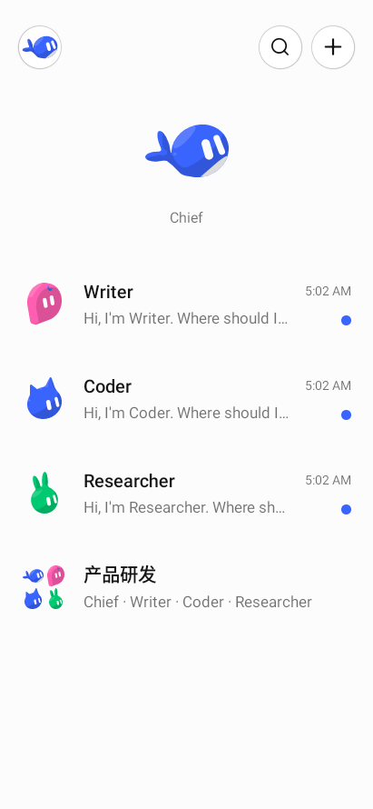
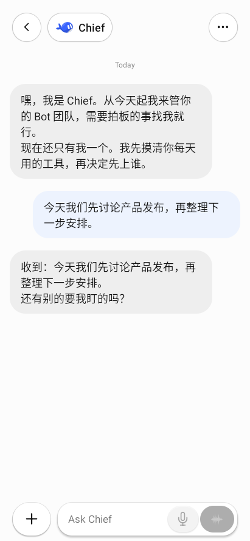
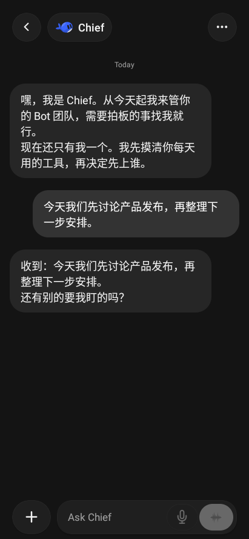
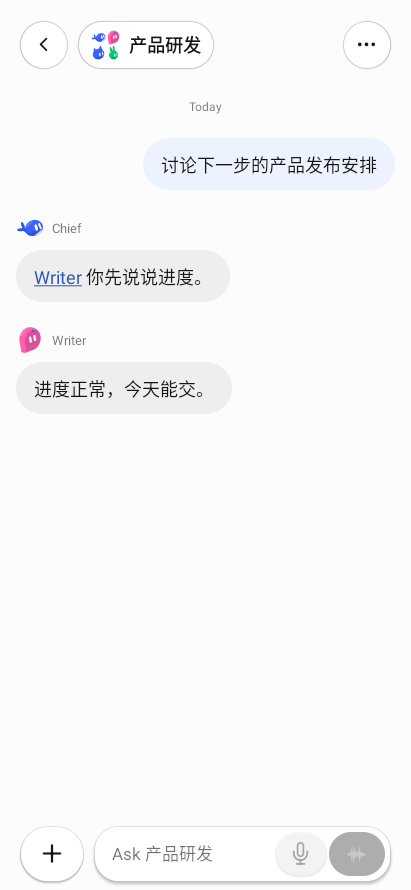
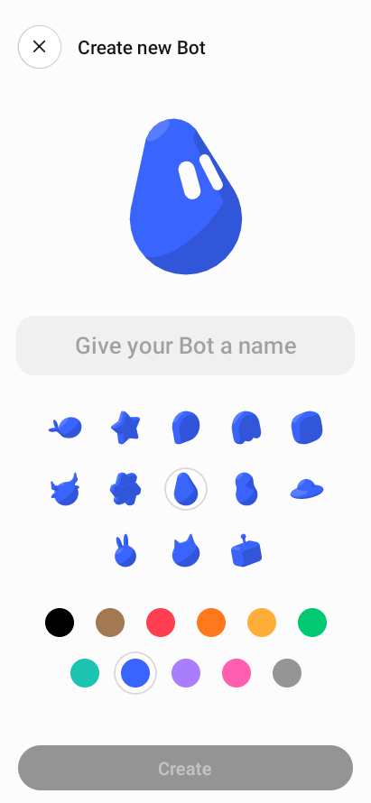
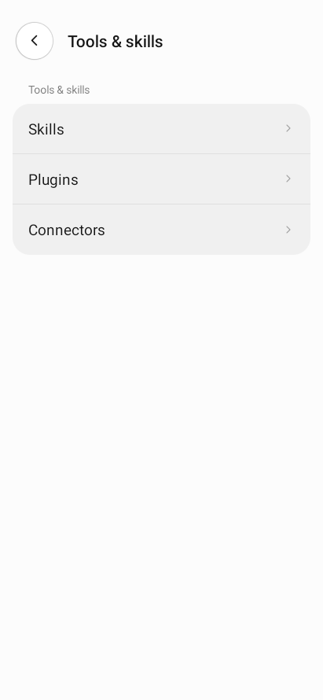

# DS Bot App

**Your Bot team, on your phone.**

English · [中文](README.zh.md) · [Install](docs/getting-started.md) · [Download](https://github.com/QingJ01/DS-Bot-App/actions/workflows/build.yml)

DS Bot App connects your phone to the Bots running on your own [DeepSeek Harness](https://github.com/deepseek-ai/deepseek-harness) (DSH) computer or server. Chat with a specialist, bring several Bots into a group, and follow their tools and tasks from one app. The phone shares the host's conversations, models and workspace.

  
  
  

Conversation home · Bot chat · Dark mode

## What you can do

| Feature | In the App |
| --- | --- |
| Bot team | Create and personalize Bots, choose their models, and assign Main Bots to manage the team. Each Bot keeps a long-lived conversation. |
| Group work | Bring Bots together, pick an administrator, mention a member or reference another conversation. See who is working or waiting for approval. |
| Messages and media | Stream replies and reasoning, long-press for message actions, attach images/files, and use voice input or voice chat. |
| Tools and host management | Open tool-result cards, approve or reject pending actions, manage supported Skills/plugins/connectors, and opt into desktop browser control. |
| Tasks and memory | Manage scheduled tasks and Bot memory, search earlier conversations, and inspect usage from settings or details. |
| Notifications | Receive Android runtime notifications with an optional foreground service. FCM/APNs are unnecessary for that mode; cloud push is optional. |
| Appearance and language | Chinese/English, light/dark/system appearance, original fish graphics, and floating chat controls. Cached conversations and drafts remain available offline. |

  
  
  

Group chat · Create a Bot · Tools & skills

These are real Android App screenshots from an isolated demonstration team using a mock model. Only the App content is captured; Android system bars are excluded. The screenshots show the interface; they do not represent results from a production model.

## Get started

1. **Download matching packages.** From [Build plugin and Android](https://github.com/QingJ01/DS-Bot-App/actions/workflows/build.yml), download `dsbot-plugin` and `dsbot-android-arm64` from the same successful run and extract the ZIPs. If a [Release](https://github.com/QingJ01/DS-Bot-App/releases) is available, use its matching `.tgz` and signed `.apk`. APK names ending in `-unsigned` are not installable. `x86_64` is for emulators.
2. **Install the host plugin.** In DSH, open Plugins → Add plugin and select the downloaded `ds-bot-0.1.2.tgz` by its absolute path. Enable it and restart DSH. Configure a model/provider credential on the host and test Chief there.
3. **Install the phone App.** Install the signed ARM64 APK on your Android phone. Earlier debug-signed test builds require uninstalling before switching to the project release signature; host history stays on the computer.
4. **Pair on Wi-Fi.** On the computer, open DS Bot Settings → Mobile devices → Enable phone connection. Scan the QR in the App, then approve the device on the computer.

The plugin generates local HTTPS automatically. On the same reachable Wi-Fi, no domain, additional app or certificate installation is needed. The native App verifies the host public key from the QR. Keep the host running; changing networks or enabling Wi-Fi isolation can prevent access.

**Install this repository's plugin tarball.** The npm package `ds-bot` belongs to the upstream project and does not include this fork's complete mobile implementation.

[Full setup tutorial](docs/getting-started.md) · [One-click HTTPS](docs/mobile-local-https.md) · [VPS and remote access](docs/mobile-install.zh.md)

## Where things run

The DSH host runs the models, Bots, tools and scheduled tasks and stores their authoritative history. The phone sends requests and displays results; it keeps a local message/draft cache and stores pairing credentials in secure storage. Model credentials are configured on the host. A disconnected phone can read its cache and edit drafts; new work requires a connection to the running host.

## Requirements and current scope

- **Android:** standalone ARM64 APK for phones and x86_64 APK for emulators. CI builds, native pairing/chat, pinned HTTPS and runtime background notifications have been validated in an emulator. Physical-device microphone, lifecycle and accessibility checks remain useful before distribution.
- **iOS:** source is included; it has not been compiled or device-tested in this Linux environment. Building requires macOS/Xcode and Apple signing. iOS does not provide Android's persistent notification service.
- **Host:** official npm integration baseline DSH `0.2.0-rc.2`; CI also checks `0.2.1-alpha.1`. Voice needs host Voice Input and FFmpeg; scheduled tasks need the Schedule service; browser control needs an opted-in DSH Desktop host. Some plugin-specific interfaces remain on the computer.
- **Background:** runtime notifications require the phone to remain connected and its receiver to run. Force-stop, battery restrictions and network loss can interrupt delivery. Optional Expo cloud push needs EAS and platform credentials.

## Build and contribute

[GitHub Actions](.github/workflows/build.yml) checks the plugin, SDK and App, packs the plugin, and builds both Android architectures. The encrypted `DeepSeekBot` signing key (`C=CN`) and public certificate are versioned; the password is supplied by the `ANDROID_KEYSTORE_PASSWORD` Actions Secret. Missing signing credentials produce clearly named unsigned artifacts. `mobile-v*` tags can publish matching signed packages as prereleases.

| Guide | Link |
| --- | --- |
| Installation and configuration | [Getting started](docs/getting-started.md) |
| Signing, Actions artifacts and releases | [Release guide](docs/releasing.md) |
| App development and feature boundaries | [Mobile App README](apps/mobile/README.md) |
| Plugin configuration and internals | [Plugin README](ds-bot/README.md) |
| Tests and contribution workflow | [Contributing](CONTRIBUTING.md) |
| Local phone / wireless debugging | [Local debugging](docs/mobile-local-debug.zh.md) |
| Upstream port and validation history | [Upstream notes](docs/mobile-upstream.zh.md) · [Validation record](docs/mobile-validation.zh.md) |

Source layout: `apps/mobile/` is the App, `packages/mobile-sdk/` the shared client, and `ds-bot/` the host plugin and mobile bridge.

## Credits and license

This project builds on [DeepSeek Harness](https://github.com/deepseek-ai/deepseek-harness) and the upstream [DS Bot](https://github.com/Fei2411/DeepSeek-Bot). The mobile client uses React Native and Expo; the plugin interface is bundled with esbuild. See [NOTICE](NOTICE) for third-party notices and [CHANGELOG](CHANGELOG.md) for changes.

[Apache License 2.0](LICENSE). DS Bot App is an independent community project, not an official DeepSeek product. Bots use your configured model quota and execute the tools available on your host; review important actions before approval.
