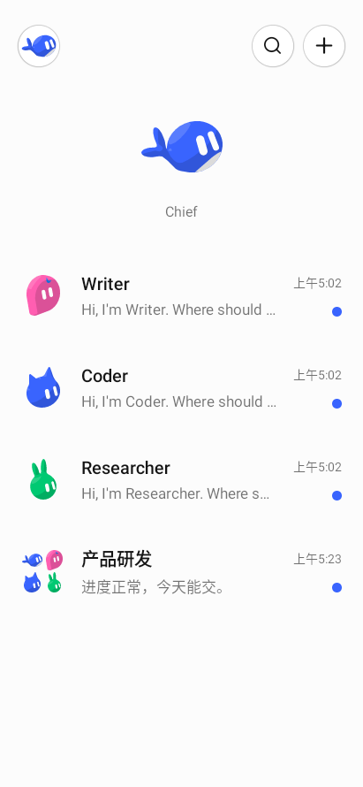
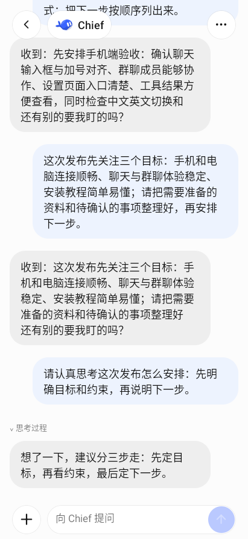
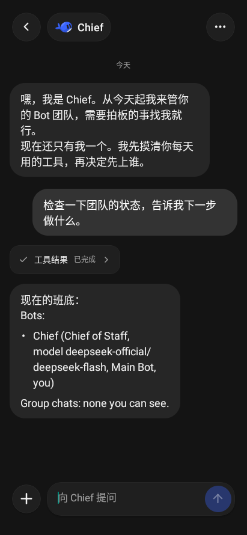
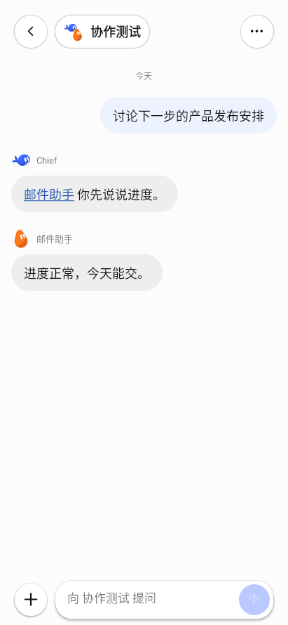
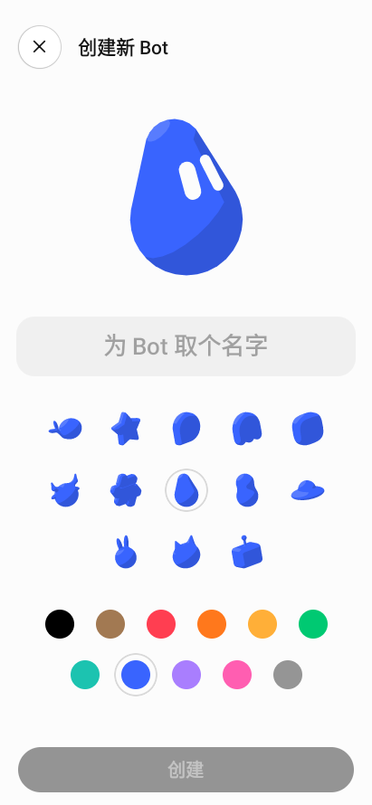
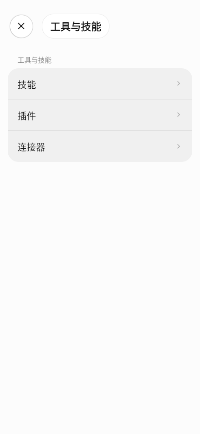

# DS Bot App

**把你的 Bot 团队，带到手机上。**

中文 · [English](README.md) · [安装配置](docs/getting-started.zh.md) · [下载](https://github.com/QingJ01/DS-Bot-App/releases/tag/v0.1.0)

> 本分支已同步上游 DS Bot v0.1.4，包含修复后的手机聊天控件。最初撤回的 v0.1.0 源码保存在 `archive/withdrawn-v0.1.0`；请安装当前 Release 的配套插件与 App。

DS Bot App 连接自己电脑或服务器上的 [DeepSeek Harness](https://github.com/deepseek-ai/deepseek-harness)（DSH）。你可以和专业 Bot 对话，让多个 Bot 在群聊中协作，并在手机上查看工具执行、管理任务。手机与电脑共用同一套会话、模型和工作区。

  
  
  

会话主页 · Bot 对话 · 夜间模式

## 可以做什么

| 功能 | 手机端体验 |
| --- | --- |
| Bot 团队 | 创建 Bot，自定义名称、角色、头像和模型；指定 Main Bot 管理团队。每个 Bot 保留长期对话。 |
| 群聊协作 | 组建 Bot 群聊、选择管理员、@ 成员或引用其他对话；查看谁正在工作、谁在等待批准。 |
| 消息与多模态 | 流式回复与思考，长按消息操作，附加图片和文件，语音输入与语音对话。 |
| 工具与主机管理 | 专属工具结果卡片，允许/拒绝待批准操作，管理支持的 Skills、插件和连接器，以及可选桌面浏览器控制。 |
| 共享能力 | 在手机上选择每个 Bot 可使用的 MCP 服务、技能和能力包，查看连接与批准状态；能力库在 DSH 电脑上配置。 |
| 任务与记忆 | 管理定时任务和 Bot 记忆，搜索历史对话，在设置或详情页查看用量。 |
| 通知 | Android 可开启前台接收服务获取运行时通知；此模式无需 FCM/APNs，云推送为可选项。 |
| 外观与语言 | 中英文、日间/夜间/跟随系统，原创鱼形图案与悬浮聊天控件；离线可查看缓存和编辑草稿。 |

  
  
  

群聊协作 · 创建 Bot · 工具与技能

以上为原生 Android App 的实际截图，只截取 App 内容，不含系统状态栏与导航栏。演示团队运行在隔离主机上，使用模拟模型；截图展示界面，不代表真实模型的生成效果。

## 快速开始

1. **下载配套文件。** 使用 [v0.1.0 Release](https://github.com/QingJ01/DS-Bot-App/releases/tag/v0.1.0) 中的插件 `.tgz` 和已签名 ARM64 `.apk`。开发构建也可在 [Actions](https://github.com/QingJ01/DS-Bot-App/actions/workflows/build.yml) 的同一次成功运行中下载 `dsbot-plugin` 和 `dsbot-android-arm64`，解压 ZIP。文件名含 `-unsigned` 的 APK 不能安装；`x86_64` 用于模拟器。
2. **安装主机插件。** 在 DSH **插件 → 添加插件** 中填下载的 `ds-bot-0.1.0.tgz` 完整路径，安装、启用并重启。模型和提供商凭据在电脑配置，先确认 Chief 能在电脑正常回复。
3. **安装手机 App。** Android 手机安装已签名 ARM64 APK。此前使用调试签名的测试包需先卸载，再切换到项目签名；电脑上的聊天记录不受影响。
4. **同一 Wi-Fi 下配对。** 电脑打开 DS Bot **设置 → 手机设备 → 启用手机连接**，手机扫码，然后回到电脑批准该设备。

插件自动生成本地 HTTPS。在两端可直达的同一 Wi-Fi 下，无需域名、额外 App 或手动安装证书；原生 App 根据二维码中的公钥验证主机身份。电脑需要保持运行；换网络、访客 Wi-Fi 或路由器隔离可能影响连接。

**请安装本仓库的插件包。** npm 上的 `ds-bot` 属于上游项目，不包含此分支的完整移动端实现。

[完整安装教程](docs/getting-started.zh.md) · [一键 HTTPS](docs/mobile-local-https.zh.md) · [VPS 与远程访问](docs/mobile-install.zh.md)

## 数据和任务在哪里运行

模型、Bot、工具和定时任务运行在 DSH 主机，主机保存会话的权威历史。手机负责发出请求和展示结果，本地缓存消息与草稿，并用安全存储保存配对凭据。模型密钥配置在主机。手机断线后可以查看缓存、编辑草稿；执行新任务需要重新连接正在运行的主机。

## 使用要求与当前范围

- **Android：** 手机使用独立 ARM64 APK，模拟器可使用 x86_64 APK。CI 构建，以及原生配对、聊天、公钥验证和运行时后台通知已在模拟器验证；发行前还应检查真机麦克风、后台生命周期与无障碍体验。
- **iOS：** 已包含源码，尚未在当前 Linux 环境编译或真机验证。构建需要 macOS/Xcode 和 Apple 签名；iOS 不提供 Android 式常驻通知服务。
- **主机：** 官方 npm 联调基线为 DSH `0.2.0-rc.2`，CI 另检查 `0.2.1-alpha.1`。语音需要主机 Voice Input 与 FFmpeg；定时任务需要 Schedule 服务；浏览器控制需要 DSH Desktop 提供能力并明确启用。部分插件专属界面仍需电脑操作。
- **后台通知：** 手机需要保持连接且接收服务运行。强制停止、电池限制或网络中断可能影响接收。可选 Expo 云推送需要 EAS 与平台凭据。

## 开发与构建

[GitHub Actions](.github/workflows/build.yml) 检查插件、SDK 和 App，打包插件，并构建两种 Android 架构。仓库保存加密的 `DeepSeekBot` 签名文件（国家 `CN`）及公开证书；密码由 Actions Secret `ANDROID_KEYSTORE_PASSWORD` 提供。未配置时产物明确标注为未签名。`v*` 标签在校验版本和发布说明后发布配套已签名包的正式版本。

| 文档 | 入口 |
| --- | --- |
| 安装与配置 | [新手教程](docs/getting-started.zh.md) |
| 签名、Actions 下载与发布 | [发布教程](docs/releasing.zh.md) |
| App 开发与功能边界 | [移动端 README](apps/mobile/README.md) |
| 插件配置与内部结构 | [插件 README](ds-bot/README.md) |
| 测试与贡献流程 | [贡献指南](CONTRIBUTING.md) |
| 手机本地与无线调试 | [本地调试](docs/mobile-local-debug.zh.md) |
| 上游移植与验证历史 | [上游说明](docs/mobile-upstream.zh.md) · [验证记录](docs/mobile-validation.zh.md) |

源码目录：`apps/mobile/` 为 App，`packages/mobile-sdk/` 为共用客户端，`ds-bot/` 为主机插件和手机桥接。

## 致谢与许可

本项目基于 [DeepSeek Harness](https://github.com/deepseek-ai/deepseek-harness) 和上游 [DS Bot](https://github.com/Fei2411/DeepSeek-Bot) 开发。移动端使用 React Native 与 Expo，插件界面使用 esbuild 打包。第三方声明见 [NOTICE](NOTICE)，更新记录见 [CHANGELOG](CHANGELOG.md)。

[Apache License 2.0](LICENSE)。DS Bot App 是独立社区项目，并非 DeepSeek 官方产品。Bot 使用你配置的模型额度和主机工具，请在批准前核对重要操作。
