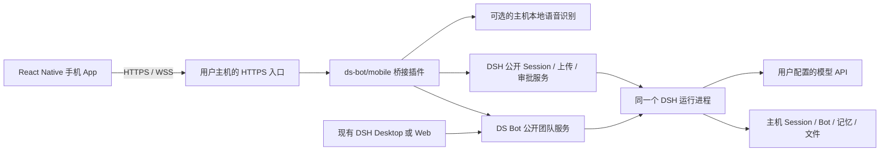

# DeepSeek-Bot 独立移动客户端改造方案

> 历史设计基线：本文在实施前制定，保留范围、架构和后续路线图。文中的拟议功能、里程碑与估算不是当前实现或验收结果。当前部署方式和实际限制以[移动端指南](mobile.zh.md)为准。

日期：2026-10-11。方案依据：DeepSeek-Bot `351ae74`、DSH `dsh-v0.2.1-alpha.1` / `5badb15` 的仓库代码与公开接口文档。

已确认范围：独立 iOS / Android App；聊天、语音、多模态、Bot 团队；首版连接用户自己的电脑或 DSH 服务器，不要求电脑关机后仍可使用。本次交付为方案，未实现移动端或修改应用源码。Grok 是聊天体验参考，本文不声称对其最新版本做了逐项竞品审计；品牌、素材和界面表达使用本项目自己的设计。

**建议先做原生手机界面与可选的主机桥接插件。**沿用 DSH 的模型调用、Session、Bot、群聊与记忆，手机负责输入、展示、媒体采集和连接恢复。不要同时引入自建模型引擎、云账号、多租户或订阅平台。

用户最终获得的体验是：电脑启动 DSH，手机扫码配对，打开即可向 Chief 提问；也能选择其他 Bot、进入群聊、发送图片和文件、录音转文字、朗读回复。手机退后台后，主机继续执行已经接收的工作；电脑休眠或停止 DSH 后，手机显示离线，保留缓存与草稿。

**现有架构的复用边界如下。**目前桌面应用和 Bot 执行在主机，模型推理通常通过配置的云 API 完成。移动 App 不改变模型提供商，也不会自动把电脑文件迁到云端。

| 现状 | 可以复用 | 必须增加或调整 |
|---|---|---|
| 每个 Bot 是 DSH Session，自动压缩和分段 | Bot 身份、指令、模型、长期历史与记忆 | 手机消息投影、跨分段时间线与稳定会话 ID |
| `/api/bot` 提供团队管理端点 | Bot/群聊/记忆等业务逻辑 | 公开 team service 和版本化移动接口 |
| Web 聊天依赖 DSH 宿主服务与页面插槽 | 业务数据和模型能力 | 原生页面、导航、输入框、消息列表；DOM/CSS 不能直接搬进 React Native |
| 现有 `send` 仅发送文本，每次生成随机 requestId | DSH 底层发送与排队能力 | 客户端幂等键、发送回执、图片/文件内容、重试查询 |
| DSH 公开 Session API 支持历史与订阅 | `prompt/page/follow/control/cancel/updateQueue` | 独立移动传输协议和恢复状态机 |
| Web 语音使用浏览器识别与朗读 | 识别后走普通文本对话的流程 | 原生录音与播放、主机识别适配、音频中断处理 |
| DSH 有可选的实验性本地 SenseVoice 服务 | 可评估整段录音识别，无需先造 ASR 引擎 | 启用、模型准备、音频格式转换和跨平台性能验证 |
| 图片可交给视觉模型，不支持时可转成文字描述 | 现有视觉路由和 OCR 缓存 | 手机上传、预览、能力提示与上传生命周期 |
| `state.json`、Session 日志、SQLite 等在主机 | 主机继续作为权威数据源 | 设备登记、提交记录、已读水位等少量桥接数据 |
| Electron Bot 浏览器 | 原有桌面能力保留 | 不直接移植为手机远程浏览器；放入后续独立评估 |

**首版以聊天为中心，但保留 Bot 的真实语义。**默认进入 Chief 或上次使用的 Bot。聊天列表展示 Bot 的长期对话及群聊；内部 Session part 属于上下文管理，不是用户主动创建的新话题。跨 part 的历史应在一个时间线连续展示。

首版 `＋` 提供新建 Bot / 新建群聊 / 添加附件等明确动作，不用“新聊天”偷偷替换当前 Bot 的上下文。真正类似 Grok 的独立话题列表可作为下一阶段：使用现有普通 DSH Agent 的多个 Session 建立“普通助手话题”，与长期 Bot 对话分别建模。当前代码确有普通 Agent 多 Session 能力，但它们不自动具有 Chief 的团队角色。不能承诺新话题完全忘记旧内容，却仍注入同一份 Bot 记忆。

| 页面 | 首版内容 | 交互重点 |
|---|---|---|
| 连接与配对 | 扫码、手动地址、服务器身份确认、连接检测 | 明确电脑须开机、DSH 须运行，显示主机名称 |
| 聊天 | 流式消息、Markdown、代码块、复制、系统分享、停止、草稿 | 输入框固定在键盘上方，长回复不强制拉回底部 |
| 对话列表 | Chief、其他 Bot、群聊、未读、Bot 筛选与已缓存消息搜索 | 缓存搜索说明范围；主机全历史搜索放到后续 |
| 团队 | 成员、角色、模型、创建/编辑 Bot、群成员与群管理员 | 优先角色和当前状态，复杂提示词设置折叠 |
| Bot 详情 | 模型、指令、记忆查看与删除、用量 | 删除记忆、删除 Bot 和停止任务是不同操作 |
| 群聊 | 按成员显示发言、@ 指定成员、群通知和成员管理 | 保留群私聊隔离，不显示成员隐藏 Session |
| 语音面板 | 录音、取消、转写、编辑、发送、朗读与停止 | 显示采集、识别、模型回答、朗读各自状态 |
| 设置 | 服务器、已配对设备、工作区、外观、缓存、诊断 | 单主人模式不展示多余的账户充值入口 |

导航可采用“聊天 / 团队 / 设置”三个入口，语音直接从输入栏打开。界面支持深浅色、安全区域、动态字号、屏幕阅读器和至少约 44pt/48dp 的触控目标。新 App 建立中英文资源；现有插件文案继续遵循仓库约定。第一版手机纵向优先，平板布局后续补充。

视觉方向采用干净的对话画布、低干扰的黑白灰基础色与一个项目强调色。主页把注意力留给输入和回复，模型名与 Bot 身份放在顶部；附件、录音与发送是输入区最直接的动作。Bot 头像沿用项目自己的角色设计，工具详情和团队配置放入可展开卡片或底部面板。录音、收到回执与错误提供克制的触觉反馈；流式文字增量展示，用户上翻历史时不抢滚动位置。这样对齐随手提问的体验，同时维持本项目的视觉识别。

**功能分期要同时覆盖四个目标，但控制每个目标的深度。**

| 能力 | V1 必须完成 | V1.1 / 后续 |
|---|---|---|
| 聊天 | 文本、流式、停止当前生成、历史分页、复制分享、失败状态、草稿恢复 | 普通助手独立话题、消息编辑分支、重新生成 |
| 语音 | 完整录音转写，允许编辑后发送；系统 TTS 朗读 | 连续语音、流式转写、全双工打断 |
| 多模态 | 相机/相册图片、文件选择上传下载；至少 TXT/MD 闭环 | PDF 稳定解析/OCR、复杂 Office 文档、图像生成、视频理解 |
| Bot 团队 | Chief、Bot 管理、现有群聊与 @ 协作、活动状态、需用户回答的卡片 | 持久任务中心、成果索引、模板市场、计划与预算面板 |
| 记忆 | 查看、删除和明确的记忆范围 | 复杂记忆整理与跨话题知识库 |
| 多设备 | 两台手机及桌面同时查看；会话同步、已读水位、设备撤销 | 跨服务器统一搜索与迁移 |
| 后台 | 返回 App 后补齐消息和状态 | APNs/FCM 完成通知 |
| 连接 | 一个已配对主机，HTTPS，断线诊断；架构中保留 serverId | 多主机切换、面向普通用户的一键联网助手 |
| 运维 | 本机/自建服务器运行说明、版本握手、日志导出脱敏 | 自动发布、兼容矩阵扩大 |

V1 的“文件上传成功”不等于“任意模型都理解任意格式”。图片理解需要已配置视觉模型或可用的图片转文字路线。通用文件由主机现有工具处理，首版逐项列明已验证格式。PDF 若没有经过解析、引用和大文件测试，就显示附件可下载，不宣传为已支持文档问答。

**技术架构采用 React Native + TypeScript，以及同一 DSH 进程中的可选 Bridge。**



Bridge 与现有桌面使用同一个 DSH 进程、同一份数据。不要另起一个“手机 DSH”同时写同一个 `DSH_HOME`；项目存在单写入进程锁。若使用自建服务器，则那台服务器是运行主机，手机只是连接它，不会因此同步用户电脑的桌面数据。

Bridge 建议作为 `ds-bot` 的可选入口或伴随插件加载：在本项目中增加公开 team service，现有 Web channel 和 Bridge 调用同一业务实现。Bridge 使用公开 `ctx` 服务，不导入 Harness 安装目录的内部文件，不修改 Harness 源码，不复制 Agent loop。新 HTTP/WSS 监听器须受插件生命周期管理，卸载或退出时停止接受请求并释放资源。

现有 DSH 浏览器连接是 loopback 和 cookie 设计，文档明确不接受 Authorization bearer，`--host 0.0.0.0` 也不是支持的启动方式。因此手机的 bearer/设备认证只属于新 Bridge；不能把现有 DSH 端口直接暴露到外网，或通过伪造 Host/Origin 绕过原有校验。

| 层 | 推荐选择 | 选择原因与限制 |
|---|---|---|
| 手机 UI | React Native + TypeScript | 沿用 React 技能，原生键盘/录音/相机与系统分享更合适 |
| 移动构建 | Expo development build / prebuild | 利用成熟模块；不要假设 Expo Go 可承载全部原生音频和网络能力 |
| 导航与状态 | Expo Router；查询缓存 + 小型 UI 状态库 | 选定维护良好的组件，避免引入多个重复状态系统 |
| 消息列表 | 虚拟化列表、增量更新、受限 Markdown 渲染 | 长历史不整页重绘，避免把所有消息放入 WebView |
| 手机缓存 | SQLite；凭证进入 Keychain / Keystore | 消息和媒体按服务器分区，退出/移除主机时可清理；敏感内容按需启用 SQLCipher 并验证原生构建 |
| 网络 | HTTPS 请求 + WSS 事件流 | REST 负责命令/查询，WSS 负责当前活跃会话；离开页面取消无用订阅 |
| Bridge | Node/TypeScript 或与项目一致的 ESM 实现，轻量 HTTP 服务 | 通过公开接口适配，不为首版引入独立 Java/Python 业务后台 |
| 协议 | JSON Schema/OpenAPI + 共享 DTO 与客户端 SDK | App 不直接依赖 DSH 内部复杂事件格式 |
| 主机存储 | 沿用 DSH；Bridge 增加小型 SQLite/受支持存储 | 仅保存设备、幂等记录、已读水位、版本和映射 |
| 语音 | 原生录音 + DSH 可选本地 ASR；手机系统 TTS | 真机验证是前置条件；实时语音独立立项 |
| 测试 | 现有 Node/mock 流程 + Bridge 合同测试 + Maestro 或同类真机流程 | 以行为与协议校验为主，不依赖易失效的 CSS 选择器 |

Flutter 和 Swift/Kotlin 双原生也能实现。当前项目是 JS/React，React Native 的团队切换成本更低。只有在原生音频验证发现无法满足要求时，再针对该模块下沉 Swift/Kotlin，无需先写两套完整客户端。

**连接先保证可信配对，再考虑便捷联网。**建议流程为：在电脑启用 Mobile Bridge → 主机进入两分钟左右的配对窗口 → 显示带连接地址、主机标识和一次性随机凭据的二维码 → 手机验证 HTTPS 和主机身份 → 电脑确认设备 → 颁发可独立撤销的设备凭证。

二维码不包含模型 API Key、永久管理口令或 DSH 浏览器启动 token。配对窗口关闭或凭据使用后失效，限制尝试次数。手机将刷新凭证存入系统安全存储，短期访问凭证用于 Bridge 请求；主机保存设备登记和可验证的凭证信息，支持单设备撤销和关闭全部移动访问。撤销要终止已有连接，不只是拒绝下一次登录。

已配对设备代表同一位主人，不引入共享团队成员账号。可以提供只读与交互两类设备权限，但必须真实约束 Bridge 能力；“允许聊天”可能触发主机工具执行，不能把它描述成纯文本权限。电脑原有 DSH 工具授权仍有效，手机审批只增加合法的回答渠道。

| 部署位置 | 首版推荐路径 | 使用者需要知道 |
|---|---|---|
| 自己的电脑，家庭或外出访问 | 受控私人网络，例如 Tailscale；配置经过验证的 HTTPS 入口 | 手机和主机都需联网并加入同一网络；HTTPS/设备策略需一次性设置 |
| 固定自建 DSH 服务器 | 私网访问优先；已有域名时可用 Caddy 等做 Bridge 的 TLS 终止 | 保留 Bridge 设备认证；反向代理只指向移动 Bridge |
| 本地开发 | 模拟器 loopback、测试证书或受控测试配置 | 明文与证书例外不能带入发布版，不全局关闭 TLS 校验 |

不为 V1 自建 NAT 穿透或中继网络。公网域名不是产品首版的必需条件；公网部署需要完整 HTTPS 与认证，不以“隐藏端口”充当安全方案。跨网络支持由所选私网方案提供，App 应明确区分主机不可达、证书错误、配对失效、模型请求失败。

**移动接口要提供稳定的业务合同。以下均是拟新增接口，不是当前已存在的 URL。**

| 接口示意 | 用途 | 必要约束 |
|---|---|---|
| `GET /mobile/v1/capabilities` | 协议版本、模型能力、上传限额、ASR/审批支持 | 未认证仅暴露最少连接信息，具体能力在认证后返回 |
| `POST /mobile/v1/pairings/claim` | 一次性配对 | 主机确认、过期、限流、防重放 |
| `POST /mobile/v1/auth/refresh` | 设备续期 | 轮换、撤销、设备关联 |
| `GET /mobile/v1/conversations` | Bot/群聊列表 | 返回稳定逻辑会话 ID 与类型，隐藏成员内部 Session |
| `GET /mobile/v1/conversations/:id/messages` | 统一历史分页 | 可信游标，跨 part 合并，权限和归属校验 |
| `POST /mobile/v1/submissions` | 文本与附件发送 | 客户端 requestId、目标 Session 绑定、接受回执 |
| `GET /mobile/v1/submissions/:requestId` | 查询不确定的发送结果 | 断线后先查询，避免盲目重复发送 |
| `POST /mobile/v1/conversations/:id/cancel` | 停止当前生成 | 取消请求与实际停止分开显示，不等于清空队列 |
| `POST /mobile/v1/uploads` | 向绑定 Session 上传 | 大小、类型、并发、剩余空间与 receipt 校验 |
| `GET /mobile/v1/attachments/:id` | 获取可访问附件 | 验证会话归属，不接收任意主机绝对路径 |
| `POST /mobile/v1/transcriptions` | 录音转文字 | 明确提供者、超时与取消，默认不自动发送文字 |
| `POST /mobile/v1/approvals/:id/answer` | 手机回答主机审批 | 只回答仍活跃的请求，一次生效，内容和范围绑定 |
| `WSS /mobile/v1/events` | 回复、活动、队列、审批、团队变化 | 版本化事件、恢复游标、心跳和过期凭证处理 |

现有 DSH `prompt` 支持 requestId 去重、`follow` 支持恢复游标，Bridge 应复用这些能力。`/api/bot` 现有 send 每次生成随机 UUID，不应直接作为移动重试接口。协议可统一用 HTTP 状态表达参数、认证、冲突、限流错误，不机械照搬旧端点的“HTTP 200 + ok:false”。

发送回执只证明请求已被接受，不表示模型已完成，更不表示外部工具写操作成功。建议显示 `草稿 → 提交中 → 已接受/排队 → 生成中 → 完成`，并有失败、需回答、请求取消、已停止等独立状态。重复点击或断线重试复用同一 clientRequestId；去重记录需要跨进程重启保存，旧 Session 分段切换后也能找到原始接受结果。外部工具副作用仍需要工具本身的幂等与授权机制，不能承诺全系统“恰好一次执行”。

**同步设计要分别处理长期会话、持久事件与临时流。**Bridge 的协议至少区分 serverId、runtimeGeneration、conversationId、dshSessionId、clientRequestId、durable eventSeq，以及临时回复的 attemptId/chunkIndex。不要把每个 token 当作一条持久消息。

App 先显示本地缓存，随后建立观察并取得一致快照，按持久游标补齐缺口。断线期间的暂态文字可以丢弃后从权威快照重建；最终消息替换同一次回复的临时气泡，不能重复显示。主机重启时 runtimeGeneration 改变，清理旧活动/审批状态，重新取得快照。

当前团队元数据使用 revision 轮询；首版可保留前台有界轮询，实际消息用公开 follow 流订阅。手机后台暂停网络活动，回前台重新认证、同步和订阅，不依赖 iOS/Android 长时间维持连接。已读水位放在主机按设备和逻辑会话保存；若希望桌面一起同步，必须给现有 Web 客户端加入对该服务的调用，而不是声称手机新增表后桌面 localStorage 就自动同步。

离线允许阅读已缓存内容和编辑草稿。V1 不自动补发离线消息；重新连通后让用户重试，先查询之前是否已接受。已被主机接受的工作可在手机后台继续；主机休眠、崩溃或退出后不保证自动续跑。重启后先还原日志与状态，标明中断，不自动重放有副作用的操作。

**附件与会话切换要一起设计。**当前 upload receipt 严格绑定实际 Session，而 Bot 的逻辑对话可能切换 part。移动端先取得带版本的提交目标，再上传；发送时 Bridge 校验目标是否仍有效。发生切换时返回明确冲突，并通过受支持流程重新准备上传，不把旧 receipt 强塞给新 Session。

首版采用整文件重试和进度显示，不承诺断点续传。建议初始产品上限为图片每张 10 MiB、普通文件 20 MiB、语音每段 60 秒，均须受实际 DSH 限制和主机资源共同约束，最终值在技术验证后配置。验证 MIME/实际内容、限制单设备并发和临时文件保留时间，防止手机重试填满磁盘。

模型能力由主机返回。视觉模型可直接看图片；非视觉模型只有在已配置图片转文字路线时才可使用描述结果，界面应说明这一点。群组当前以文字描述传递图片，不承诺每个成员都收到原始视觉输入。任意文件路径、任意 shell RPC 和浏览器 cookie 都不应成为 Mobile API 的通用参数。

**语音分三步交付。**

| 阶段 | 用户体验 | 技术实现与验收 |
|---|---|---|
| V1 | 录一段话，检查转写后发送；回复可点按朗读 | 原生录音；优先验证主机可选 SenseVoice 服务；手机系统 TTS |
| V1.1 | 连续按轮说话与回答，自动检测停顿 | 明确录音/识别/生成/播放状态，蓝牙、来电和路由切换验证 |
| V2 | 低延迟双向语音、随时打断 | 单独验证流式 ASR/TTS、VAD、回声控制、实时传输与服务商成本 |

仓库已有的浏览器 SpeechRecognition/speechSynthesis 无法直接当作 React Native 方案。DSH 的 `ctx.speechToText` 是实验性接口，目前仅支持完整录音识别，没有流式识别或语音合成方法；本地服务还要求 16 kHz、单声道、PCM16 WAV。手机常见 AAC/M4A 录音须在受控适配层规范化，或使用确认可输出目标格式的原生模块。

技术验证必须覆盖选定的 Windows/macOS/Linux 主机平台、模型下载、首次准备和识别耗时。若本地 ASR 不满足硬件要求，可提供显式选用的云 ASR provider；需要用户配置凭证和同意上传音频，不能静默退回云服务。原始录音默认在转写完成后按短期策略清理，保留文字；系统 TTS 的声音可用性及是否需要网络依设备设置而定。

M0 先按用户实际设备确定首发主机平台；完整 V1 至少验证一种主机平台和一条可用 ASR 路线。其他主机平台即使已能文字聊天，也不能计为语音验收通过。下述工期不隐含 Windows、macOS、Linux 三种主机的所有音频组合均已支持；iOS 与 Android 客户端仍各需真机验收。

**Bot 团队首版沿用已有协作，不另造任务执行引擎。**手机展示谁正在工作、谁在等待用户回答、哪些工具已经产生结果、最终回答是什么。显示工具摘要和来源，不把内部推理当作用户进度。群聊天与 Bot 私聊继续隔离。

当前 roomProgress、activity、部分 inbox 是进程内状态，群日志还存在长度上限，不能直接拿来做永久“任务中心”。V1 使用持久 Session 历史还原聊天、展示可验证的当前活动。后续需要任务卡、成果索引和跨重启恢复时，再定义 Task/Artifact 的持久数据合同。

“停止当前生成”与“删除排队消息”分开：DSH cancel 不会清空 inbox。用户点停止后，不应立刻显示所有任务已经取消。团队轮次、并行数和重试设置要有明确上限；预算限制若上线，需要在主机模型调用链上执行，不能只在 App 提示。V1 用量以 token 和语音时间展示，费用为基于提供商价格的估算，不假装已有精确账单系统。

**审批是一条主机能力，不是手机按钮。**通过公开 `approval/request` 机制增加移动端回答入口，电脑和手机共享一次性请求；第一条有效回答生效，其他设备同步结果。主机重启、请求过期或工具调用已取消后，旧审批卡只能展示结果，不能再放行。

实现上必须使用同一个主机审批仲裁器。DSH 公开合同要求一个 terminal answerer，不能并列注册两个 waterfall listener，就假设能自动广播和竞答。M0 需要确认受支持的配置组合或公开扩展点能将桌面、手机都接入该仲裁器；若当前桌面回答器缺少这种入口，V1 保留桌面审批，手机显示等待电脑确认，或先请求上游扩展。下表中的手机审批验收只适用于实际启用并通过此验证的能力。

当前审批合同未保证携带全部工具参数。涉及目标文件、外部接收方或发布内容的请求，需要从公开且可验证的数据取得具体对象；拿不到必要信息就保留在桌面确认或暂停该动作，不编造详情、不为接入手机绕过现有授权。密钥继续留在主机，App 不需要保存模型 API Key。

**后台推送不进入 V1 的必要范围。**手机返回 App 后恢复状态是首版验收项；被系统挂起时即时收到任务通知不是。用户关机后主机无法继续执行，推送也不能改变这一点。

后续有两条路线：个人签名构建由自己的服务器直接调用 APNs/FCM，需要自己维护开发者项目与服务端凭证；通用分发版本通常需要发行方维护小型推送中继，承担鉴权、设备 token、限流和重试。通知默认仅含任务/会话标识及通用提示，不发送完整聊天正文。发行方推送密钥不能打包进手机或分发给任意自托管主机。增加中继意味着增加云服务运维，应单独决策。

**建议的仓库演进位置如下，仅为拟议目录，不在本次创建。**

```text
ds-bot/                         保留现有插件与 Web 客户端
  src/host/team-service.js       拟新增公开团队业务服务
  src/mobile/                   可选 Bridge、设备认证、公开 API 适配
apps/mobile/                    React Native 手机工程
packages/mobile-protocol/        DTO、schema、版本协商
packages/mobile-sdk/             传输、回执、同步、消息投影
tests/mobile-contract/           Bridge 合同、去重与恢复验证
docs/mobile/                    连接指南、架构与真机验收记录
```

目录落地前确认 npm 插件的发布 files/exports，避免把手机构建产物或测试凭证打进插件包。首版可以给手机工程独立 package/lockfile，暂不为了移动端迁移整个仓库的包管理方式。共享代码限于类型、纯数据转换和语义明确的业务能力；不要把 window/localStorage/DOM 依赖带入共享层。

先固定已验证的 DSH 版本，Bridge 暴露自己的协议版本与 capabilities。遇到不兼容版本给出明确升级说明。实验性 ASR 可单独协商能力，不能因它缺失导致文本聊天无法启动。缺少必要的 DSH 扩展点时，申请上游支持或缩小该项功能；不使用源码补丁作为正常安装步骤。

**实施先完成风险最大的纵向链路。以下周期是假设估算，不是已验证工期。**假设 1 名 React Native 开发、1 名后端/DSH 开发，设计和测试兼职，使用现有模型 API，首批约 5–20 位受邀用户，各自连接自己的 DSH 实例，不共享同一个主人身份；不做商业订阅、实时双向语音和推送中继。

| 阶段 | 预计时间 | 交付与通过条件 |
|---|---|---|
| M0：技术验证与交互稿 | 3–5 个工作日 | 同一 DSH 进程加载 Bridge；一台真机配对、发送、流式、历史、取消；确定主机/ASR 路线，验证单一审批仲裁器扩展点 |
| M1：连接与客户端骨架 | 1–1.5 周 | iOS/Android 构建，HTTPS 与设备撤销，版本握手，本地缓存；扫码失败/证书错误/主机离线均有明确状态 |
| M2：聊天与同步 | 1.5–2 周 | Bot/群列表、连续历史、稳定提交 ID、停止与队列状态；杀进程/切网后消息不丢失、不重复提交 |
| M3：图片、文件与语音 | 1–1.5 周 | 图片实际被模型使用；TXT/MD 上传下载；录音转写编辑发送与朗读；跨 part 上传冲突可恢复 |
| M4：团队与审批 | 1–1.5 周 | Bot 管理、群聊、记忆、用量、待回答卡、受支持的手机审批；电脑与手机抢答只生效一次 |
| M5：真机可靠性与内测 | 1–1.5 周 | 两台设备同步、长列表、主机休眠/重启、媒体权限、iOS/Android 分发包和部署文档 |

加上集成与兼容缓冲，建议按 **8–10 周的内测版**规划。单人全职、熟悉项目但需同时承担两端开发时，按 **12–18 周**更稳妥。若 M0 发现公开服务适配、Windows 音频或审批信息需要上游改动，应重新估算相关项，不隐藏进度风险。公开商店上架、开发者账号申请和审核时间另外安排。

可以更早交付 3–4 周的技术预览：配对、文字聊天、历史、基础 Bot 列表和断线恢复。它不等于已完成用户要求的语音、多模态和团队操作。

**首版验收必须基于行为与故障场景。**

| 场景 | 验收标准 |
|---|---|
| 基本连接 | iOS、Android 真机连接同一主机；一次性配对不能复用；撤销设备后已有连接也不能继续发命令 |
| 发送防重 | 同一 requestId 重试 10 次，只对应一次接受记录；发送确认丢失后能查询结果；不据此宣称所有外部副作用恰好一次 |
| 历史一致 | 手机与桌面观察到同一持久消息；跨至少 3 个 part 的历史正确排序，群私聊不串线 |
| 流式恢复 | Wi-Fi/移动网络切换、断网后恢复、App 杀进程后重开，不留下重复的最终回复或永久转圈 |
| 主机生命周期 | 手机后台时主机继续已接受工作；主机关闭显示离线；主机重启后丢弃过期活动和审批，不擅自重放工具 |
| 停止与队列 | 停止当前 turn 后队列状态仍真实可见；删除排队项有独立确认和最终回执 |
| 多模态 | 图片理解成功；不支持时给出能力说明；超限/中断/过期 receipt 可恢复，主机磁盘不会因重试无限增长 |
| 语音 | 麦克风权限拒绝、60 秒录音、转写失败、蓝牙断开和来电中断都有可恢复状态；转写不会未经确认自动发送 |
| 团队与审批 | Chief 能管理成员，群聊按现有规则运行；启用移动审批时，并发批准只产生一次有效决策，过期审批不生效；未支持时明确转交桌面 |
| 基础性能 | 参考机与测试数据固定；本地输入反馈目标 100ms 内，缓存首屏目标 1 秒内；长历史只渲染可视窗口 |
| 服务性能 | 分开统计 App/Bridge 处理时间、主机冷启动、模型首字时间；网络与模型延迟不混为客户端指标 |
| 回归 | 现有插件单元测试、bundle 一致性和 mock smoke 保持通过；新增 Bridge 合同测试与真机关键流程 |

上述性能数字是验收目标，不是当前测量结果。开发阶段以 mock 验证重连、重复提交、取消、审批和分段；随后用用户授权的实际模型小规模验证视觉与语音质量。上一轮环境测试通过不代表未来移动改造已经通过验收。

**成本主要来自开发和模型使用，自托管首版不需要额外租一套 SaaS 后台。**

| 成本项 | 首版安排 |
|---|---|
| 主机 | 沿用现有电脑或已有 DSH 服务器；持续运行增加电力/设备占用 |
| 模型 | 沿用用户配置的 API；团队额外调用、上下文整理和图片转文字也计入用量 |
| 语音 | 本地 ASR 使用主机算力与模型磁盘；可选云 ASR 另按提供商计费；系统 TTS 不需要项目自建合成服务 |
| 网络 | 私网、域名、HTTPS、现有 VPS 依实际选择产生费用，方案不假设服务商永久免费 |
| 构建分发 | Android 可先私下分发签名包；iOS 使用开发者签名/TestFlight 等受支持渠道，需要对应账号与 macOS 或云构建能力 |
| 推送/计费 | V1 不配置中继、支付和订阅，因此不预支这些运维成本 |

聊天月成本可按实际提供商单位价格估算：输入 token（区分命中缓存）×输入单价 + 输出 token×输出单价 + 图片等额外计价 + 云语音费用。团队模式对多个 Bot 的调用求和，再加整理、OCR 和其他辅助调用，不把一次用户发送视为一次模型调用。开发预算可用人周数×实际全成本估算，避免在未确认团队和地区前给出伪精确金额。

**风险应在相应阶段被验证，而非等到上架。**

| 风险 | 处理方式 |
|---|---|
| DSH 与现有 API 仍处于早期版本 | 固定版本，Bridge 做适配，保持合同测试和升级演练 |
| 普通话题、长期 Bot、群成员隐藏 Session 混用 | 三种模型分开建模；V1 保留长期 Bot 语义 |
| 现有 Web 认证无法直接用于原生网络接入 | 独立 Bridge 设备认证，保留原有 trust fence |
| 主机重启后内存任务状态丢失 | 使用持久历史恢复事实；先标记中断，不承诺自动续跑 |
| 无法从公开审批接口取得充分细节 | 限制可在手机批准的动作，保留桌面确认；必要时请求上游扩展 |
| 录音格式、本地 ASR 性能与原生模块不一致 | M0 用真机与目标主机验证，保持显式可选提供者 |
| 文件上传时发生 Session 分段 | 提交目标版本与 receipt 绑定，冲突后走明确恢复流程 |
| 私网与证书配置阻碍用户首次使用 | 提供一种完整验证过的安装路径，避免首版支持所有联网拓扑 |
| 范围扩张到 Grok 全功能复刻 | 首版覆盖四项最小闭环，实时语音/视频/生成/付费另排期 |

建议的下一项实际开发任务是 **M0 的一条完整链路**：在同一 DSH 主机加载可选 Bridge，真机扫码配对后与 Chief 发送一条消息、看到流式输出，断网重连补齐，再撤销设备。这个验证通过后，再投入完整页面、媒体和团队管理开发。

以下是方案中关键判断的仓库依据，便于后续开发复核：

- [项目约束：插件方式、数据与源码边界](../AGENTS.md#L15)
- [现有 Bot/群聊、记忆、文件及数据目录说明](../ds-bot/README.md#L13)
- [现有文本发送端点与随机 requestId](../ds-bot/src/host/channel.js#L247)
- [团队 revision 轮询与宿主 Session 依赖](../ds-bot/src/client/index.js#L119)
- [现有浏览器语音流程](../ds-bot/src/client/voice.js#L11)
- [DSH 浏览器 cookie 与 Host/Origin 信任边界](../deepseek-harness/packages/client/connection/README.md#L39)
- [公开 Session 发送、历史、订阅和取消](../deepseek-harness/packages/api/session-controller/src/index.ts#L426)
- [公开文件上传接口](../deepseek-harness/packages/client/file-upload/src/index.ts#L114)
- [公开审批事件合同](../deepseek-harness/packages/interaction/user-approval/src/types.ts#L78)
- [单一终端审批回答器要求](../deepseek-harness/packages/interaction/user-approval/README.md#L32)
- [整段本地语音识别及格式约束](../deepseek-harness/packages/experimental/speech-to-text/README.md#L27)
- [可选语音插件包与本地提供者](../deepseek-harness/packages/experimental/voice-input-bundle/README.md#L27)
